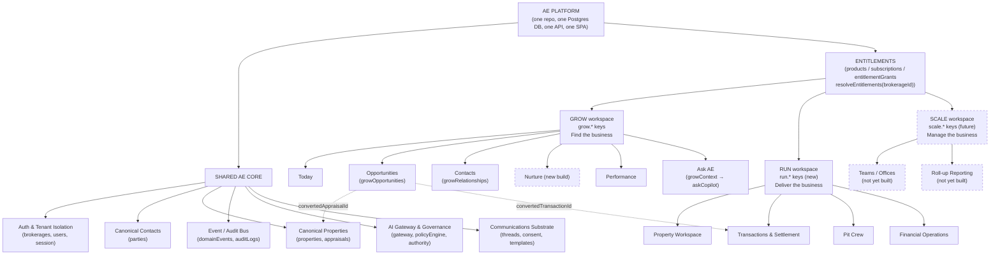

# AE Grow — Priority 0: Architecture, Entitlements and Product Boundary Review

**Review date:** 2026-09-08 AEST
**Branch inspected:** `feat/operational-readiness-pilot-gate` (PR #27), commit `f22461f89a54556f91ae9fc3a415ef88c7eccdc2`
**Method:** Inspection-only. Every finding below is drawn from reading the actual current source on this branch via the GitHub API (schema files, route files, middleware, frontend routing, and lib modules read in full or in relevant part), not from prior documentation alone. Where a documented claim and the implementation disagreed, the implementation is reported as current truth and the discrepancy is called out.
**No code was changed to produce this review.** The only repository change made is this document.

---

## 1. Executive Decision

# READY WITH MINOR FOUNDATION WORK

No stop condition was triggered. There is exactly one canonical contact record (`parties`) and one canonical property record (`properties`); Grow's own schema explicitly reuses both rather than duplicating them. Product separation does not rely on client-side hiding as a security boundary anywhere found — every sensitive route is independently re-checked server-side by `requireAuth`/`requireRole`/`requireEntitlement`. The proposed entitlement model extends, rather than weakens, tenant isolation (it is additive on top of the existing brokerage-scoped session/auth system). No substantial restructuring of authentication or canonical data would be required.

The reason this is not simply "READY FOR GROW BUILD" is that a real, working foundation already exists for roughly half of what Grow needs, while the other half — a genuine product-tier concept, frontend entitlement-aware navigation, and the AI-driven opportunity intelligence the new positioning is named for — does not yet exist and needs deliberate, bounded foundation work before Priority 1 begins in earnest. Specifically:

- The platform already has a real, tested, tenant-scoped **entitlement-grant resolver** (`apps/api/src/lib/entitlements/resolver.ts`) wired end-to-end from a billing catalogue (`products`/`prices`/`subscriptions`/`entitlementGrants` in `packages/db/src/schema/billing.ts`) through Express middleware (`apps/api/src/middlewares/entitlement.ts`). But it currently only models Grow (13 `grow.*` keys); there is no `tier` concept and no RUN/SCALE entitlement keys yet.
- The platform already has a real, tenant-isolated, production-capable **Grow CRM foundation** — relationships, activities, and opportunities, plus a well-built contact/property import pipeline (`apps/api/src/routes/grow.ts`, `packages/db/src/schema/grow.ts`, `apps/api/src/lib/import/*`). But the opportunity-*finding* intelligence the new GROW strategy is named for (scoring, nurture, prospecting) does not exist — the schema has the columns, nothing populates them.
- The platform's frontend has **no entitlement-aware navigation or routing** at all today — every gate in `apps/web/src/App.tsx` is a `user.role` string check, and the `/grow` route/link is shown to every authenticated user regardless of role or whether their brokerage has purchased Grow. This is the single most consequential gap relative to the stated philosophy that "Grow must remain simple" and must not expose the complexity of the full platform.
- A separate, disconnected, and now-stale AI-only tier system (`apps/api/src/lib/ai/entitlements.ts`) duplicates the concept of tiers with its own `STARTER|GROW|PRO` enum and a `resolveBrokerageTier()` function that is hardcoded to always return `"STARTER"` — this needs to be reconciled with (or retired in favour of) the real entitlement resolver, not carried forward as a second source of truth.
- Three dashboard surfaces (`Home.tsx`, `CommandCentre.tsx`, `FinancialOperations.tsx`) independently answer overlapping "what needs my attention" questions — the codebase's own comments already flag this as unresolved technical debt that the Grow/Run split is a natural moment to resolve, not create.

None of this amounts to an architectural blocker. It is bounded, mostly additive foundation work sitting on top of a canonical data model, auth system, and event/audit backbone that are all sound and reusable as-is.

---

## 2. Current Architecture Summary

Agent Engine 2.0 is a single pnpm-workspace monorepo, one platform, not three applications:

- **`apps/web`** — a single React SPA (Vite, `wouter` for routing), one `App.tsx` route table and sidebar shared by every user regardless of role.
- **`apps/api`** — a single Express API (`apps/api/src/app.ts`), organised as `routes/*.ts` (one file per domain — auth, properties, parties, appraisals, transactions, offers, grow, import, pitCrew, financial, billing, communications, ai, ai-actions, exceptions, tasks, integrations, aml, launch, health, metrics) backed by `lib/*` modules and `middlewares/*` (auth, entitlement, error handling, rate limiting, request id, HTTP metrics).
- **`packages/db`** — one Drizzle/PostgreSQL schema (`packages/db/src/schema/*.ts`, 23 files, one Postgres database, no per-product database split) covering users/tenancy, billing, property, grow, appraisal, transaction, workflow, documents, communications, ai, events, audit, exceptions, pitCrew, financial, integrations, import, aml, privacy, launch, automation, commerce.
- **`packages/domain`, `packages/events`, `packages/integrations/*`** — shared, cross-cutting packages: canonical-source registry, the domain-event bus (publish/subscribe with a handler registry), and integration adapters (AML, billing, e-sign, mandate-payments, object storage, payments, property-data), each wrapped in fail-closed mock/live provider abstractions.

**Tenancy**: a `brokerages` table is the real, first-class tenant. Every `users` row belongs to exactly one `brokerageId`. Authentication is a single cookie-session mechanism (`apps/api/src/middlewares/auth.ts` + `apps/api/src/lib/session.ts`) that attaches both `role` and `brokerageId` to `req.authedUser` in one place — this is the one and only place tenant context and role originate, and every downstream check (entitlement resolution, tenant-isolation checks, role gates) reads from it. There is no fragmentation in this layer.

**Roles**: exactly three, by deliberate design (`packages/db/src/schema/users.ts`, `USER_ROLES = ["Agent", "Brokerage Administrator", "Pit Crew"]`), documented in-code as "deliberately small… grown later by deliberate decision, not accretion."

**Entitlements**: a real, tested, tenant-scoped grant/key resolver already exists (`apps/api/src/lib/entitlements/resolver.ts`, explicitly labelled "Grow Stage A" in its own header), fed by a genuine billing catalogue → subscription → entitlement-grant pipeline (`packages/db/src/schema/billing.ts`), synchronised from a mock/Stripe billing gateway (`apps/api/src/lib/billing/{catalogue,gateway,sync}.ts`) and enforced per-route via `apps/api/src/middlewares/entitlement.ts`. This is architecturally the right shape for GROW/RUN/SCALE but is currently populated with Grow-only data.

**Where documentation and implementation disagree**: `ARCHITECTURE.md`'s tracked phase sequence (Foundation → Start Property → Ready to List → AML → Documents → Payments → Offers/Transactions → Agent Command Experience → Contextual AI → Property Timeline) has no dedicated "Grow" phase, and one of its own sections lists "prospecting" and "nurture campaigns" as explicitly out of scope. In fact a substantial, real "Grow Stage A" build (CRM relationships/activities/opportunities, entitlements, billing, and the import pipeline) already exists in the code, tracked instead in code comments and in `docs/CONTROLLED_PILOT_PLAN.md` rather than in `ARCHITECTURE.md`'s own phase list. `docs/CONTROLLED_PILOT_PLAN.md` §A.3 is the most current and most honest existing account of the Run/Grow/Scale gap and should be treated as more authoritative than `ARCHITECTURE.md` on this specific question; it already states plainly that "the actual billing catalogue is 'Starter'/'Grow'/'Pro+Grow Bundle' — there is no 'Scale' product, price, or entitlement anywhere in the codebase," and that current "Grow" scope (as coded) bundles CRM, Pit Crew, and success-fee billing together — a boundary that does not match the new strategy's placement of Pit Crew under RUN. This is a real scope/naming reconciliation the business should make deliberately (see §5–§7 below), not a discovery that anything is broken.

---

## 3. Current Grow Assessment

**Existing Grow routes**: `GET /grow/access` (unauthenticated-safe entitlement/billing-provider check), `GET /grow/overview`, `GET/POST/PATCH /grow/relationships`, `GET/POST /grow/activities`, `GET/POST /grow/opportunities` (`apps/api/src/routes/grow.ts`); plus the import pipeline under `apps/api/src/routes/import.ts`. Frontend routes: `/grow` → `Grow.tsx`, `/grow/import` → `GrowImport.tsx`.

**Existing Grow screens**: `Grow.tsx` is an entitlement-gated workspace (locked screen with a Brokerage-Administrator-only "Add Grow" checkout CTA when not entitled; otherwise three stat tiles — Relationships, Activities logged, Open opportunities — and three sections: Relationships, Recent Activity, Opportunities). `GrowImport.tsx` is a CSV/XLSX contact-and-property import wizard (upload → column mapping → validation → duplicate review/merge → preview → execute → rollback).

**What genuinely works today vs. placeholder**:

| Capability | Status |
|---|---|
| Relationship/Activity/Opportunity CRUD, tenant-isolated, entitlement-gated | **Production-capable.** Real Postgres writes, real tenant scoping via `parties`/`properties`, real domain events (`RELATIONSHIP_CREATED`, `RELATIONSHIP_UPDATED`, `OPPORTUNITY_CREATED`), explicitly recommended for pilot inclusion by the project's own gate documentation. |
| Contact/property import pipeline (12-stage: ingest→parse→normalise→map→validate→dedupe→resolve→preview→import→verify→audit) | **Production-capable.** Writes only into the same canonical `parties`/`properties`/`growRelationships` tables — "never a parallel imported-record table," per its own header comment. |
| Entitlement/billing gating for Grow specifically (`grow.access` and 12 sibling keys) | **Production-capable.** Real server-side enforcement (`requireEntitlement`), independent of any UI hiding. |
| Opportunity scoring (`confidenceScore`, `scoreExplanation`, `scoreVersion`, `recommendedNextAction`, `nextActionDueAt`) | **Placeholder — schema-complete, never populated.** Columns exist on `growOpportunities`; no code anywhere writes to them. `apps/api/src/lib/ai/context/growContext.ts`'s `buildGrowContext()` — the one place the AI layer could read Grow data — is an explicit stub that always returns `null`. |
| Opportunity stage-transition / conversion to Appraisal or Transaction | **Partially implemented.** The FKs (`convertedAppraisalId`, `convertedTransactionId`) and `stage` enum (New→Contacted→Qualified→AppraisalBooked→Converted→Lost) exist on the table; the route file only exposes create/list, not a transition or convert endpoint. |
| Automated nurture / prospecting / lead-sequencing | **Does not exist.** No table, route, or sequencing code anywhere in the repository. `docs/CONTROLLED_PILOT_PLAN.md` states this outright: "no automated nurture/lead-scoring exists to pilot." |
| Frontend nav/route gating for Grow by entitlement | **Absent.** The `/grow` sidebar link and route are shown to every authenticated user unconditionally; the page's own entitlement check is documented in-code as "a rendering convenience only," with the real boundary enforced server-side. |

**Existing Grow data dependencies**: Grow already uses the canonical `parties` table (its relationship/opportunity/activity rows all key off `partyId`), the canonical `properties` table (optionally, since `growOpportunities.propertyId` is nullable — an opportunity can exist before a property is chosen, while `growRelationships.propertyId` is currently `NOT NULL`), and conversion targets into the canonical `appraisals` and `transactions` tables. It publishes into the shared domain-event bus. It does **not** yet touch AI (the `growContext` stub), communications/nurture sequencing (none exists), or a party-keyed timeline (the existing `lib/timeline.ts` projection is keyed by `propertyId`, not `partyId`).

---

## 4. Shared AE Core

| Capability | Reuse status | Why |
|---|---|---|
| Authentication (cookie session, `middlewares/auth.ts`, `lib/session.ts`, `lib/auth/*`) | **READY TO REUSE** | Single mechanism, already attaches both role and tenant (`brokerageId`) to every request; Argon2id password hashing, CSPRNG tokens, session-epoch revocation, brute-force lockout all already hardened. No Grow-specific auth should ever be introduced. |
| Tenant isolation (`brokerages` as first-class tenant; every domain table brokerage-scoped) | **READY TO REUSE** | Confirmed as a genuine first-class entity, not "office as tenant by convention." Grow, Run, and every other domain already scope through the same `brokerageId`. |
| Users / roles (`USER_ROLES`) | **READY TO REUSE** | Deliberately small, stable enum; correctly kept orthogonal to product access in the backend's own middleware naming (`requireRole` vs `requireEntitlement` are already two distinct concepts). |
| Canonical contact record (`parties`) | **READY TO REUSE** | One table, brokerage-scoped, generic person/organisation record, already the join target for both Run (`propertyParties`) and Grow (`growRelationships`, `growOpportunities`, `growActivities`). No duplication found. |
| Canonical property record (`properties`) | **READY TO REUSE** | One table; lifecycle vocabulary (`WORKFLOW_STAGES`) is Run-flavoured but the table itself is generic and already referenced (optionally) by Grow. |
| Entitlement/billing engine (`entitlementGrants`/`products`/`subscriptions`, `lib/entitlements/resolver.ts`, `middlewares/entitlement.ts`, `lib/billing/*`) | **REQUIRES EXTENSION** | The mechanism is sound, tested, and fail-closed, but only 13 `grow.*` keys and a `grow`/`agent_engine_starter`/`agent_engine_pro_grow_bundle` product set currently exist. No `run.*`/`scale.*` keys, no explicit tier concept, and the "Starter" product (textually the closest thing to today's RUN) has zero entitlement rows seeded. |
| AI gateway (`lib/ai/gateway.ts`, provider abstraction) | **READY TO REUSE** | Generic, provider-agnostic LLM call wrapper with retry/fallback; not tied to any one feature. |
| AI governance (`policyEngine.ts`, `authority.ts`, `protectedOperations.ts`, `lib/ai/roles.ts`) | **READY TO REUSE** | Mature, fail-closed authority/risk model; already anticipates expansion — `BusinessCoachRole` and `ProactiveIntelligenceRole` exist today as typed, not-yet-implemented stubs, which map closely onto Grow's "AI Performance Coach" and "AI-assisted opportunity identification." |
| AI-specific tier/entitlement/feature-flag layer (`lib/ai/entitlements.ts`, `lib/ai/featureFlags.ts`) | **NOT SUITABLE as currently built** | A second, disconnected `SubscriptionTier` enum whose `resolveBrokerageTier()` is hardcoded to always return `"STARTER"`, stale relative to the real entitlement system that now exists elsewhere on this same branch. Should be reconciled with (ideally retired in favour of) the general entitlement resolver rather than extended further. |
| Communications infrastructure (`lib/communications/*`, `communications` schema) | **REQUIRES EXTENSION** | Mature, provider-neutral thread/message/consent/cost/quiet-hours substrate — but explicitly "not a CRM, not a bulk-marketing platform" per its own header comment; no campaign/sequence concept exists yet, which Nurture (Priority 8) will need on top. |
| Integration framework (`lib/integrations/*`, `packages/integrations/*`) | **REUSE WITH MODIFICATION** | Fail-closed adapter/registry pattern is sound and reusable, but every configured provider today is `MOCK` classification; real external property-data (comps/valuation/market-trend/ownership-history) does not exist in any form, mock or real, beyond AU address autocomplete. |
| Audit/event architecture (`domainEvents`, `auditLogs`, `packages/events/src/{publisher,registry}.ts`) | **READY TO REUSE** | Mature, decoupled event bus already used by Grow's own routes (`RELATIONSHIP_CREATED`, `OPPORTUNITY_CREATED`); new Grow AI/nurture activity can publish/consume through the same bus with no new plumbing. |
| Document storage, transaction/workflow engine, Pit Crew, financial/PC-fee engine | **READY TO REUSE (hidden, not modified, for Grow)** | Mature, hardened, evidenced by multiple prior remediation passes (optimistic concurrency, tenant-isolation alerting, immutable versioned calculations, separation-of-duties). This is RUN's engine; Grow should never see or touch it. |
| Observability | **REQUIRES EXTENSION** | Thin today (`lib/observability/queueGauges.ts` only); most signal actually flows through `@aee/events`' logger/counter calls used ad hoc throughout. Adequate for current scale, not a Grow blocker, but worth strengthening as product surface area grows. |
| Frontend entitlement/session awareness (`useSession`, `App.tsx` nav) | **NOT SUITABLE as currently built** | `SessionUser` carries `role` only, no entitlement/product field; there is no `useEntitlement` hook; all nav/route gating in `App.tsx` is a hand-rolled `user.role === …` check, and the `/grow` route has no client-side gate at all. This must be extended before Grow can "feel like a standalone simple product." |

---

## 5. Grow Product Boundary

Grow should own, and be the only product surface presenting:

- The existing Grow CRM data model as-is: `growRelationships`, `growActivities`, `growOpportunities`, reusing canonical `parties`/`properties` — no new tables needed for the record-keeping layer itself.
- The existing contact/property import pipeline (already Grow-scoped and production-capable).
- A new, party-keyed "Contact Intelligence / Relationship Timeline" view — the existing `lib/timeline.ts` pattern (event/audit projection with category mapping and redaction) should be mirrored keyed by `partyId` rather than `propertyId`, not rebuilt from scratch.
- A new, simple "Today" command centre — the existing `Home.tsx`/`lib/homeSummary.ts` model (flat, brokerage-scoped, no financial/Pit Crew content by construction, explicitly documented as "not a BI dashboard") is structurally very close to what Grow's "Today" screen should look like already, and is the natural retrofit target rather than a new build.
- New AI capabilities layered onto existing stubs: opportunity scoring/next-action recommendation (populating the already-existing `growOpportunities` columns, likely via the `ProactiveIntelligenceRole` stub), an AI Performance Coach (the already-existing `BusinessCoachRole` stub), and Nurture/prospecting sequencing (new — no existing sequencing engine, though the message-send/consent/template substrate in `lib/communications/*` can be reused underneath it).
- New "Ask AE" scope: the existing `askCopilot()` orchestrator already provides a context-aware Q&A pattern; extending its context package via `buildGrowContext()` (currently a stub) is the natural integration point rather than a new assistant architecture.
- New: a real "opportunity" external-intelligence source for Priority 10 — today only AU address autocomplete exists; comps/valuation/market-trend data would be a from-scratch integration, not an extension of anything present.

Grow must explicitly **not** carry: Pit Crew delegated work-item management, the Financial Operations queue, transaction/contract/settlement mechanics, or the exceptions/risk engine — all of that is Run/Scale-only and should be hidden by entitlement, not merely left unlinked.

---

## 6. Run Product Boundary

Run owns everything already built around "deliver the business": Property Workspace (`PropertyWorkspace.tsx`), the transaction/workflow engine (`transactions`, `transactionConditions`, `workflows`/`workflowSteps`), offers, appraisals (as the delivery-side use, distinct from Grow's pre-listing use of the same table), documents, AML, launch/campaign management, Pit Crew (`pitCrew` schema/routes/lib), the Financial Operations queue and PC-fee/commission engine, and the richer `CommandCentre` (now/today/overdue/waitingOn/comingUp/activeProperties/pitCrew/completedToday). None of this needs to be rebuilt or restructured for the new strategy — it needs a `run.*` entitlement family placed in front of it, using the same `requireEntitlement` mechanism already protecting Grow.

Two concrete, bounded pieces of new work belong to Run specifically, not to Priority 0/1 of Grow: (1) the PC success-fee rate is trivially configurable (`pcFeeAuthorities.rateBps`) so 10.9% requires only new catalogue/config data, but the $20,000-per-year cap does not exist in any form today (`maximumAmountCents` caps one settlement, not a rolling annual total) and needs new summation logic before Run's real commercial terms can go live; (2) `apps/web/src/pages/FinancialOperations.tsx` self-describes in its own header as "a foundation for the Command Centre, not the Command Centre itself" and `lib/pitCrew/queries.ts` documents an outstanding intent to repoint Pit Crew's dashboard at `CommandCentre` that was never completed — this consolidation should happen as part of standing up Run's own defined dashboard boundary, not be left as three overlapping surfaces indefinitely.

---

## 7. Scale Product Boundary

There is currently no code, schema, route, or entitlement for Scale anywhere in the repository — confirmed both by direct schema/lib directory inspection (no `teams.ts`, `offices.ts`, `franchise.ts`, or `organizations.ts`, no team/office/franchise module under `apps/api/src/lib/`) and by the project's own `docs/CONTROLLED_PILOT_PLAN.md` §A.3 ("Scale — OUT OF SCOPE. No code, schema, or entitlement for a 'Scale' tier exists anywhere in this repository… This is correctly absent, not a gap to remediate.").

The good news architecturally: a `brokerage` is already inherently multi-user (many `users` rows share one `brokerageId`), so the base tenant unit Scale would sit on top of already exists and is sound. What does not exist is any hierarchy above or across that unit — teams within a brokerage, roll-up reporting across a multi-office/franchise structure, or agent-to-agent permission delegation. Scale should be treated as **future, additive schema work** (a `teams`/`offices` layer, plus `scale.*` entitlement keys and roll-up reporting views) once Grow and Run are stable — it is not a Priority 0/1 blocker and should not be spec'd in detail until the business is ready to build it, per the review's own instruction not to create speculative abstractions the strategy doesn't yet require.

---

## 8. Entitlement Recommendation

**Recommended model: extend the existing entitlement-grant mechanism with a small, explicit product/tier vocabulary — do not introduce a parallel system, and do not conflate role with entitlement.**

- **Organisation entitlement**: continue using `entitlementGrants` scoped to `brokerageId` (already correct — grants are already brokerage-scoped, not user-scoped, matching "the organisation purchased this product," and the `office`/`team` grant types already fail closed pending a real tenancy-membership table for Scale). Add a small, explicit set of `run.*` and (later) `scale.*` entitlement keys alongside the existing `grow.*` keys, seeded via new `products` rows (`run`, and eventually `scale`) in the same `products`/`prices`/`productEntitlements` catalogue already used for Grow — this is config/data, not new architecture. Introduce a thin `productCode → tier` concept only if the business needs to reason about "which tier is this org on" as a single value; the underlying enforcement should still be per-key, not per-tier, so that RUN customers who haven't purchased every RUN feature (or bundle customers with a mix) remain expressible.
- **User role**: keep `USER_ROLES` exactly as-is (`Agent`, `Brokerage Administrator`, `Pit Crew`) — these answer "what can this person do," not "what has this org purchased," and should continue to be enforced by `requireRole`, completely independent of entitlement checks. An administrator at a Grow-only brokerage remains an administrator; they simply have no `run.*`/`scale.*` entitlements to exercise.
- **Feature access**: continue enforcing entitlement server-side via `requireEntitlement` on every route (already the correct pattern; do not weaken it to a client-only check). Retire or reconcile `lib/ai/entitlements.ts`'s separate `SubscriptionTier`/`resolveBrokerageTier()` — either delete it in favour of AI roles checking `hasEntitlement(actor, "ai.business_coach")`-style keys through the real resolver, or make `resolveBrokerageTier()` genuinely derive from `entitlementGrants` instead of being hardcoded. Carrying two independent, disagreeing entitlement systems forward is the one thing in this review that should not be allowed to persist past Priority 1.
- **Navigation filtering**: this is the concrete new work needed. Extend `useSession()`/`SessionUser` (or add a sibling `useEntitlements()` hook backed by a new `GET /entitlements` or reuse of `GET /grow/access`-style endpoints generalised across products) so `apps/web/src/App.tsx` can filter both the sidebar `links` array and the route `Switch` by product entitlement, exactly the same way `canSeeFinancial`/`canSeePitCrew` already filter by role today. A Grow-only brokerage's nav should show Today/Opportunities/Contacts/Nurture/Performance/Ask AE and nothing else; a Run brokerage's nav should show the existing Property/Command-Centre/Pit-Crew/Financial set. This is additive to the existing pattern, not a rewrite of it.
- **Backend enforcement**: unchanged in mechanism, extended in coverage — every Run/Scale route not currently behind `requireEntitlement` (most of them are only behind `requireRole` today, e.g. `routes/pitCrew.ts`, `routes/financial.ts`) should gain a `run.*` entitlement check in addition to, not instead of, its existing role check, mirroring exactly how `routes/grow.ts` already layers `requireAuth` + `requireEntitlement` together.

---

## 9. Grow → Run Data Flow

```
Contact (parties)
   │  growRelationships (party ↔ property, historical, rich taxonomy incl. prospective_buyer/seller)
   ▼
Opportunity (growOpportunities: partyId required, propertyId optional, stage New→Contacted→Qualified→AppraisalBooked)
   │  convertedAppraisalId ─────────────────────────────┐
   ▼                                                      ▼
Appraisal (appraisals, keyed by propertyId)     [already a canonical, first-class entity — no new table needed]
   │  "Listing Won" ⇒ property.workflowStage progresses into Run's WORKFLOW_STAGES
   ▼
RUN: property enters Run's existing lifecycle (Ready to List → Listed → Under Offer → Contract → Settlement → Closed)
   │  offers → transactions.acceptOffer() (already implemented)
   ▼
Transaction (transactions: ContractPreparation → UnderContract → SettlementScheduled → Settled → Closed)
   │  convertedTransactionId (growOpportunities → transactions, FK already exists)
   ▼
Settlement (lib/transactions.ts completeSettlement() — already auto-triggers commission calc)
   ▼
PC success fee (pcFeeAuthorities + computePcFee() — rate already configurable; annual cap NEW logic needed)
```

This flow requires **no data migration** between Grow and Run: `growOpportunities.convertedAppraisalId`/`convertedTransactionId` already point at the real canonical `appraisals`/`transactions` tables rather than duplicating them, and both stages share the same canonical `parties`/`properties` rows throughout. What is genuinely missing is the *transition logic* connecting the stages: an API endpoint that marks an opportunity "Converted" and creates/links the appraisal (today `POST /grow/opportunities` only creates the opportunity row itself, with no conversion action), and — on the reverse side — nothing currently writes back to `growOpportunities` when a property tied to it reaches "Listed" in Run, so the handoff today would need to be completed by a person, not automatically reflected. This is additive work (new service functions + 1-2 new routes), not a redesign.

---

## 10. Existing Functionality Reuse Matrix

| Functionality | Classification | Notes |
|---|---|---|
| Auth / session / tenant isolation | KEEP | Hardened, unified, must not be touched except for genuine blockers (none found). |
| `parties` / `properties` canonical tables | KEEP, REUSE | Single source of truth for both Grow and Run; no duplication. |
| `growRelationships` / `growActivities` / `growOpportunities` | KEEP, REUSE | Already correctly shaped and additive to canonical data. |
| Grow import pipeline | KEEP, REUSE | Production-capable onboarding step Grow still needs. |
| Entitlement resolver + billing catalogue | REUSE, MODIFY | Sound mechanism; needs `run.*`/`scale.*` keys and product rows added. |
| `lib/ai/entitlements.ts` (AI-only tier system) | DEPRECATE LATER / CONSOLIDATE | Disconnected duplicate of the real entitlement system; hardcoded `resolveBrokerageTier()`. Reconcile before it's extended further. |
| `App.tsx` nav/route gating | MODIFY | Add entitlement-aware filtering alongside existing role-based filtering; currently the `/grow` route has no gate at all. |
| `Home.tsx` / `lib/homeSummary.ts` | MOVE (retrofit as Grow's "Today") | Structurally already close to a Grow-appropriate simple dashboard; currently unused/duplicative of `CommandCentre`. |
| `CommandCentre.tsx` / `lib/commandCentre/*` | KEEP, REUSE (Run/Scale) | Already section-modular (now/today/overdue/…); financial visibility already parametrized (`canViewFinancials`) — the same pattern can drive Run-vs-Grow visibility. |
| `FinancialOperations.tsx` | CONSOLIDATE LATER | Self-described in its own header as a stopgap pending folding into Command Centre; do this as part of, not incidental to, the Run boundary work. |
| `PitCrewCommandCentre.tsx` / Pit Crew engine | KEEP, HIDE FROM GROW | Mature, hardened; gate by `run.*` entitlement, do not modify. |
| Transaction / workflow / financial / PC-fee engine | KEEP, HIDE FROM GROW | Same as above; PC-fee annual cap needs NEW BUILD (see §6). |
| AI gateway / orchestrator / policy engine / authority model | KEEP, REUSE | Generic and reusable as-is for new Grow AI capabilities. |
| `BusinessCoachRole` / `ProactiveIntelligenceRole` stubs | NEW BUILD REQUIRED (implementation) | Interface/seam already exists; behaviour does not. |
| `growContext.ts` | MODIFY | Currently a stub returning `null`; needs to actually read `growOpportunities`/`growRelationships`/`growActivities`. |
| Communications infrastructure | REUSE (as substrate), NEW BUILD REQUIRED (sequencing layer on top) | Send/consent/template/cost machinery is reusable; no campaign/nurture-sequence concept exists. |
| Property-data integration | NEW BUILD REQUIRED | Only AU address autocomplete is real; no comps/valuation/market-trend/ownership-history source exists, mock or real. |
| Scale (teams/offices/franchise) | NEW BUILD REQUIRED (future, not Priority 0/1) | No existing code to reuse or hide; correctly out of scope for now. |

---

## 11. Grow Priority Readiness Matrix

| # | Priority | Status | If foundation work required, exactly what's missing |
|---|---|---|---|
| 1 | Daily Command Centre | **FOUNDATION WORK REQUIRED (small)** | Retrofit `Home.tsx`/`homeSummary.ts` (or add a "simple mode" to `CommandCentre`) as the literal Grow-tier data source; wire entitlement-aware nav so it's what a Grow user actually lands on. |
| 2 | Opportunity Engine and Opportunity Score | **FOUNDATION WORK REQUIRED (moderate)** | Table/API scaffolding exists (`growOpportunities`, create/list routes); needs stage-transition/conversion endpoints and an actual scoring implementation (e.g. via `ProactiveIntelligenceRole`) to populate the already-existing `confidenceScore`/`scoreExplanation` columns. |
| 3 | Contact Intelligence / Relationship Timeline | **FOUNDATION WORK REQUIRED (small)** | Mirror the existing `lib/timeline.ts` event/audit projection pattern keyed by `partyId` instead of `propertyId`; the underlying event/audit data already exists. |
| 4 | AI Prospecting & Nurture Assistant | **FOUNDATION WORK REQUIRED (large)** | No prospecting/nurture-sequencing engine exists at all; needs a new sequencing layer on top of the existing communications send/consent/template substrate, plus a prospecting AI role built out from the `ProactiveIntelligenceRole` stub. |
| 5 | AI Performance Coach | **FOUNDATION WORK REQUIRED (moderate)** | `BusinessCoachRole` stub and tier-gating seam already exist; needs an actual implementation and a data source (likely aggregating existing transaction/opportunity/activity data per agent). |
| 6 | Grow → Run / PC Handoff | **FOUNDATION WORK REQUIRED (moderate)** | Conversion FKs exist; needs the actual transition endpoints (§9) and, for the PC-fee side specifically, the $20,000/year cap summation logic (§6) before Run's real commercial terms can be relied on. |
| 7 | Database Health Engine | **READY TO BUILD** (data foundation) / **FOUNDATION WORK REQUIRED** (the engine itself) | Canonical `parties`/`properties` are clean and singular (a precondition for any health-scoring engine); no health-scoring/data-quality engine exists yet — this would be new, self-contained build on top of sound data. |
| 8 | Campaign & Nurture Automation | **FOUNDATION WORK REQUIRED (large)** | Same gap as Priority 4 — no campaign/sequence engine exists; communications substrate is reusable underneath it but the sequencing layer is a from-scratch build. |
| 9 | Performance / Conversion Dashboard | **FOUNDATION WORK REQUIRED (small–moderate)** | Underlying data (`growOpportunities.status/stage`, transactions, activities) exists; needs new aggregation/reporting queries and a UI, but no schema gaps. |
| 10 | External Property Data Intelligence | **FOUNDATION WORK REQUIRED (large)** | Only AU address autocomplete (Google Places) is real; no comps/valuation/market-trend/ownership-history integration exists in any form — this is a genuine new external-integration build, not an extension. |

---

## 12. Technical Debt Affecting Grow

Only items with a direct bearing on the Grow strategy are listed; general cleanup is out of scope for this review.

1. **Duplicated/disconnected AI tier system** (`lib/ai/entitlements.ts`) — a second `SubscriptionTier` enum with a hardcoded `resolveBrokerageTier()` that never actually varies, stale relative to the real entitlement system that now exists on this same branch. Left unresolved, it risks new Grow AI features being gated by the wrong (non-functional) system.
2. **Three overlapping dashboard surfaces** (`Home`, `CommandCentre`, `FinancialOperations`) answering the same "what needs attention" question at different levels of sophistication, acknowledged in the codebase's own comments as an incomplete migration (Pit Crew's dashboard was meant to be repointed at `CommandCentre` and never was). The Grow/Run split is a natural, low-risk moment to finish this consolidation rather than adding a fourth surface.
3. **No frontend entitlement-awareness at all** — every product-boundary decision the new strategy requires at the navigation layer currently has no primitive to hang off (`SessionUser` has no entitlement field; no `useEntitlement` hook exists). This is foundation work, not debt in the sense of something to clean up, but it is a genuine precondition, not an optional nicety.
4. **`growRelationships.propertyId` is `NOT NULL`** — meaning even a pure "I met a prospect, no property yet" relationship record currently requires a `properties` row to exist, which slightly cuts against Grow's "find the business before there's a property" framing. Worth a schema review (nullable column, backward compatible) before Priority 2/4 depend heavily on pre-property relationships.
5. **Naming/scope mismatch between the current "Grow" billing/entitlement boundary and the new strategy** — today's coded "Grow" entitlement bundle includes Pit Crew and success-fee billing concepts per `docs/CONTROLLED_PILOT_PLAN.md` §A.3, whereas the new strategy places Pit Crew under RUN. This should be resolved as a deliberate product decision (which `grow.*` keys, if any, actually belong under `run.*` instead) before the entitlement catalogue is extended further, to avoid encoding the mismatch permanently into new keys.

---

## 13. Minimum Foundation Changes

**MUST DO BEFORE PRIORITY 1:**

- Add frontend entitlement-awareness: a session/entitlement field or a lightweight `useEntitlements()` hook, and use it to filter `App.tsx`'s nav `links` array and route `Switch` (mirroring the existing `canSeeFinancial`/`canSeePitCrew` pattern) so a Grow-only brokerage's experience is actually simple by construction, not just by convention.
- Resolve the current mismatch between the "Grow" entitlement/billing bundle as coded (CRM + Pit Crew + success-fee billing) and the new strategy's GROW/RUN boundary — decide which existing `grow.*` keys, if any, should be renamed/moved to a new `run.*` family before more product surface is built on top of the ambiguity.
- Reconcile or retire `lib/ai/entitlements.ts`'s disconnected AI tier system before adding any new AI-gated Grow capability, so there is exactly one entitlement source of truth.
- Retrofit `Home.tsx`/`homeSummary.ts` (or add a Grow-specific simple mode) as Grow's "Today" screen, rather than building a fifth dashboard from scratch.
- Loosen `growRelationships.propertyId` to nullable if Priority 2/4 will meaningfully depend on pre-property prospect relationships (confirm this against the actual Priority 2 design before committing to the migration).

**CAN BE DONE LATER (does not block Priority 1):**

- Full consolidation of `CommandCentre`/`FinancialOperations`/Pit Crew dashboard overlap (Run/Scale-side technical debt, not a Grow blocker).
- The PC success-fee $20,000/year cap logic (needed before Run's real commercial terms go live, not before Grow's Priority 1).
- Building out `run.*`/`scale.*` entitlement keys and products beyond what's needed to keep Run hidden from Grow-only orgs (a coarse "does this brokerage have Run at all" check is sufficient to start; fine-grained per-feature Run entitlements can follow incrementally, the same way Grow's did).
- Scale/brokerage/team schema — explicitly future work, not needed for Grow or Run.
- Strengthening the observability layer.

---

## 14. Recommended Build Sequence

1. Foundation work from §13 ("must do before Priority 1") — frontend entitlement-awareness, the Grow/Run entitlement-boundary decision, AI-tier reconciliation, Home.tsx retrofit.
2. Priority 1 (Daily Command Centre) — now genuinely foundation-ready once step 1 lands.
3. Priority 3 (Contact Intelligence / Relationship Timeline) — small, self-contained, and makes Priority 2's opportunity data more visible/usable once built, so sequencing it early pays off.
4. Priority 2 (Opportunity Engine and Opportunity Score) — build the conversion/transition endpoints and a first scoring implementation.
5. Priority 9 (Performance / Conversion Dashboard) — mostly reporting over data that exists by this point.
6. Priority 6 (Grow → Run / PC Handoff) — the transition endpoints from step 4 plus the PC-fee annual-cap logic, timed to land before Run's commercial terms need to be real.
7. Priority 5 (AI Performance Coach) — implement `BusinessCoachRole`.
8. Priority 4 and 8 (AI Prospecting & Nurture Assistant; Campaign & Nurture Automation) — the largest net-new builds; sequence together since they share the sequencing-engine dependency.
9. Priority 7 (Database Health Engine) and Priority 10 (External Property Data Intelligence) — both genuinely new, independent builds; can run in parallel with the above once resourcing allows, and neither blocks nor is blocked by the others.

---

## 15. Files Likely to Change

*(Identified for planning purposes only — not modified during this review.)*

- `apps/web/src/App.tsx` — add entitlement-aware nav/route filtering.
- `apps/web/src/lib/session.ts` — extend `SessionUser`/`useSession`, or add a sibling entitlement hook.
- `apps/api/src/lib/ai/entitlements.ts`, `apps/api/src/lib/ai/roles.ts` — reconcile with the real entitlement resolver; implement `ProactiveIntelligenceRole`/`BusinessCoachRole`.
- `apps/api/src/lib/ai/context/growContext.ts` — implement to read real Grow data instead of returning `null`.
- `apps/api/src/routes/grow.ts`, `packages/db/src/schema/grow.ts` — add opportunity stage-transition/conversion endpoints; consider nullable `growRelationships.propertyId`.
- `packages/db/src/schema/billing.ts`, `apps/api/src/lib/billing/catalogue.ts` — add `run.*`/`scale.*` entitlement keys and product rows.
- `apps/api/src/routes/pitCrew.ts`, `apps/api/src/routes/financial.ts` — add `requireEntitlement("run.*")` alongside existing role checks.
- `apps/api/src/lib/financial/pcFeeCalculations.ts`, `packages/db/src/schema/financial.ts` — add annual-cap summation logic.
- `apps/web/src/pages/Home.tsx`, `apps/api/src/lib/homeSummary.ts` — retrofit as Grow's "Today" screen.
- `apps/web/src/pages/CommandCentre.tsx`, `apps/web/src/pages/FinancialOperations.tsx`, `apps/api/src/lib/pitCrew/queries.ts` — dashboard consolidation.
- `apps/api/src/lib/communications/*` — new sequencing/campaign layer on top.
- `packages/integrations/property-data/src/index.ts` — new real data-source integration.

---

## 16. Risks

- **Architectural risk**: carrying forward two disagreeing entitlement systems (the real resolver vs. `lib/ai/entitlements.ts`) increases the chance a future AI feature is gated inconsistently — low likelihood of a security issue (both fail closed independently) but real likelihood of confusing, hard-to-debug product behaviour if not reconciled early.
- **Security risk**: none found rising to a stop condition. The one item worth active tracking is that today's `/grow` route/link has zero client-side gate — currently low-risk because the real boundary is enforced server-side and no paying customers are live yet, but this should not be allowed to persist once real, differentiated GROW/RUN/SCALE customers exist, since a confusing UI (showing locked/irrelevant functionality) works against the explicit "Grow must remain simple" product goal even where it isn't a security hole.
- **Data-integrity risk**: low. No duplicate canonical records exist; the main integrity item to watch is ensuring the new opportunity-conversion endpoints correctly guard against double-conversion (e.g., an opportunity converted twice creating two appraisals) when built.
- **Migration risk**: minimal by design — the existing architecture already avoids a Grow→Run migration by sharing canonical tables and using conversion FKs rather than copies. The main risk is process, not data: if the Grow/Run entitlement-boundary naming mismatch (§12 item 5) is not resolved deliberately, some early Grow customers could end up provisioned with entitlement keys that later need to be reclassified as Run, which is an administrative correction, not a data migration, but should be planned for rather than discovered later.
- **Scope risk**: the largest remaining risk to the overall GROW strategy is that four of ten Priority items (2, 4, 5, 8) depend on genuinely new AI/automation build, not architecture reuse — the review found good seams for this work (role stubs, event bus, communications substrate) but the actual intelligence has to be built, and estimating that work accurately is the main planning risk, not anything found to be wrong with the existing platform.

---

## 17. Final Recommendation

The existing AE architecture can safely become the foundation for Grow as the primary entry product without structural remediation. The canonical data model is already correctly unified (one `parties` table, one `properties` table, shared by every product line), authentication and tenant isolation are already hardened and do not need to be touched, and a real, tested, fail-closed entitlement mechanism already exists and only needs its vocabulary extended (new `run.*`/`scale.*` keys) rather than replaced. A genuine, tenant-isolated Grow CRM foundation — relationships, activities, opportunities, and a production-capable import pipeline — already exists in the codebase today and is a real head start, not a green field.

What is required before Priority 1 begins is bounded, well-understood foundation work, not architectural rework: give the frontend an actual entitlement-awareness primitive so Grow can be simple by construction; resolve the naming/scope mismatch between today's coded "Grow" bundle and the new GROW/RUN boundary; and retire or reconcile the disconnected AI-only tier system before more AI capability is built on top of it. None of these touch security, tenant isolation, or canonical data, and none require Run or Scale to be rebuilt or migrated. On that basis, this review's decision is **READY WITH MINOR FOUNDATION WORK**, and the recommended build sequence in §14 can be authorised for planning once the AE Project Owner has reviewed this Priority 0 report.

This review does not authorise Priority 1 development, any deployment, or any change to production configuration. It is inspection-only, as instructed.

---

## Diagram — Recommended Target Structure



---

*This report was produced by inspecting the real repository content on `feat/operational-readiness-pilot-gate` via the GitHub API. No implementation work, deployment, merge, or Priority 1 development was performed or authorised.*
